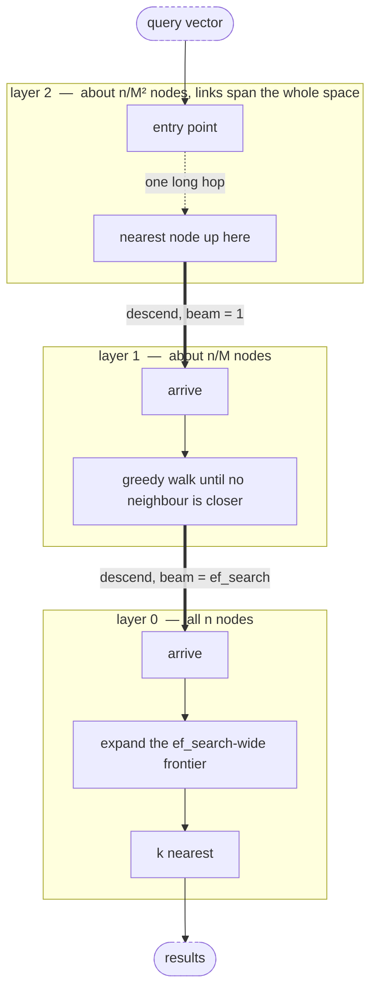
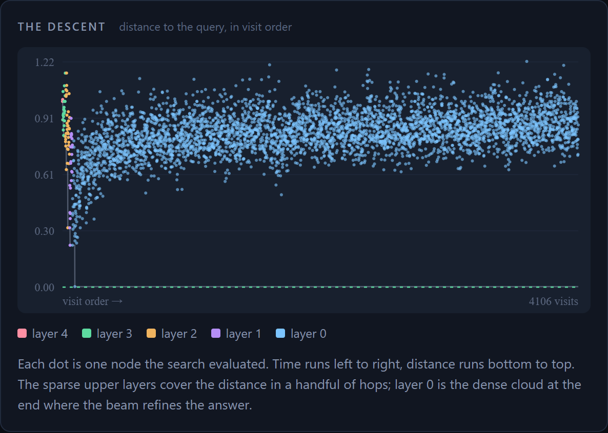

# hnsw

> **Учебная реализация, созданная вместе с AI-агентом** (август 2026). Цель — разобраться, как устроена такая система изнутри; архитектуру и ограничения автор готов объяснить. Это не production-библиотека.
> *A learning implementation built together with an AI agent; not a production library.*

[](https://www.rust-lang.org)
[](LICENSE)
[](Cargo.toml)

**Hierarchical Navigable Small World approximate nearest-neighbour search, implemented from scratch.**

[**→ Live demo**](https://aminyx.github.io/hnsw/) — the index compiles to WebAssembly, builds a real
graph over 25,000 English words in your browser tab, and shows you every hop the search takes.

---

## What this is

HNSW is the index inside essentially every vector database shipping today: Qdrant, Weaviate,
Milvus, `pgvector`'s `hnsw` access method, FAISS's `IndexHNSW`, Lucene's `knn` field. When a
retrieval system "searches embeddings", this is the data structure doing the searching.

This repository is that algorithm written out rather than called. The layered graph, the
exponential level assignment, the beam search, the neighbour-selection heuristic, the distance
kernels, the PRNG, the file format and the CRC are all here, all explained at the code that
implements them, and all measured against an exact baseline.

`Cargo.toml` has an empty `[dependencies]`.

```rust
use hnsw::{Hnsw, Metric, Params};

let mut index = Hnsw::new(768, Metric::Cosine, Params::default().with_m(16))?;
for (id, vector) in embeddings {
    index.insert(id, &vector)?;
}

// ef_search is the recall/latency dial, and the only parameter you can
// retune without rebuilding.
index.set_ef_search(64);
let hits = index.search(&query, 10)?;
```

## Results

20,000 vectors × 64 dimensions, cosine, 24 Gaussian clusters, `M = 16`, `m_max0 = 32`,
`ef_construction = 200`, 400 held-out queries, k = 10. Recall is measured against an exhaustive
scan; throughput is single-threaded, each run reported as the fastest of nine timed passes, and
every QPS figure below is the median of 15 such runs.

| `ef_search` | recall@10 | QPS | mean latency | nodes visited | % of index scanned |
|---:|---:|---:|---:|---:|---:|
| 8 | 0.8118 | 39 571 | 25 µs | 317 | 1.58 % |
| 16 | 0.9025 | 27 713 | 36 µs | 397 | 1.99 % |
| 32 | **0.9765** | **17 011** | 59 µs | 559 | 2.80 % |
| 64 | 0.9975 | 10 372 | 96 µs | 738 | 3.69 % |
| 128 | 1.0000 | 6 694 | 149 µs | 864 | 4.32 % |
| 256 | 1.0000 | 4 651 | 215 µs | 921 | 4.60 % |

The exact scan over the same data runs at **1 794 QPS**. That baseline is a genuine exhaustive
search over the same 400 queries and the same nine-pass minimum as the rows above: it computes
every one of the 20 000 distances and then picks the k best with `select_nth_unstable_by` — an
`O(n)` selection plus `O(k log k)` on the prefix — rather than fully sorting all n candidates and
throwing the tail away. At `ef_search = 32` the index answers **9.5× faster while returning
97.65 %** of the true nearest neighbours, having looked at 2.8 % of the vectors. That factor is
simply the ratio of the two medians printed above — 17 011 / 1 794 — rather than the median of
per-run ratios, so a reader can check it by dividing. Individual runs ranged from about 6× to
about 14× on two different hosts, and the spread is host load rather than anything about the
index: the exact scan's long timed passes suffer far more from a busy machine than the index's
short ones. Build took roughly 4-12 s across those runs.

50,000 vectors × 128 dimensions, 40 clusters, same parameters:

| `ef_search` | recall@10 | QPS | mean latency | nodes visited | % of index scanned |
|---:|---:|---:|---:|---:|---:|
| 16 | 0.7895 | 10 923 | 92 µs | 460 | 0.92 % |
| 32 | 0.9252 | 7 098 | 141 µs | 670 | 1.34 % |
| 64 | **0.9852** | **4 515** | 221 µs | 937 | 1.87 % |
| 128 | 0.9995 | 3 173 | 315 µs | 1 179 | 2.36 % |
| 256 | 0.9997 | 2 385 | 419 µs | 1 315 | 2.63 % |

Exact scan: **329 QPS** — the same honest baseline, every distance computed and the k best
selected with `select_nth_unstable_by`, over the same 400 queries. At `ef_search = 64`,
**13.7× faster at 98.5 % recall**, touching 1.9 % of the index — again the ratio of the two
medians printed here, 4 515 / 329. Individual runs ranged from about 8× to about 20× across two
hosts; the top of that range comes from runs where the machine was busy, which hurts the exact
scan far more than the index. Build took roughly 20-35 s depending on host load.

Notice what the two tables say together. The dataset grew 2.5× and got twice as wide; at the
same `ef_search = 64`, the number of nodes a query visits went from 738 to 937 — up 27 %, for
2.5× the data. That sublinear scaling is the entire reason the structure exists, and it is why
the second table's "% of index scanned" column is *lower* than the first's despite doing more
work per query.

Reproduce either row set with:

```sh
make bench                                  # the 20k table
make bench BENCH_N=50000 BENCH_DIMS=128 BENCH_CLUSTERS=40 BENCH_EF=16,32,64,128,256
```

Measured on an 8-core x86-64 container, `opt-level = 3`, LTO, no SIMD intrinsics. Absolute QPS
will differ on your machine; the shape of the curve will not.

## How it works

HNSW is two ideas stacked.

**A navigable small world graph.** Connect every point to a handful of near neighbours *plus* a
few long-range links, and greedy hill-climbing — repeatedly step to whichever neighbour is closer
to the query — finds the true nearest neighbour surprisingly often, in polylogarithmic hops
instead of a linear scan.

**A skip list over that graph.** A flat small-world graph still has to cross the whole space in
small steps. So each node draws a random top layer from a geometric distribution, and layer `l`
holds only the nodes whose top layer is at least `l`. Layer 0 holds everything; each layer up
holds roughly `1/M` of the layer below. The search descends: a cheap greedy walk through the
sparse upper layers covers enormous distances in very few hops, because up there the points are
far apart and so are the links. By the time it reaches layer 0 it is already in the right
neighbourhood and only needs to refine.



### Level assignment

```text
l = floor(-ln(unif(0, 1]) * mL)
```

This gives `P(l ≥ i) = exp(-i / mL)`, so layer populations decay geometrically and the expected
number of layers is `O(log n)`. Setting `mL = 1 / ln(M)` makes the ratio exactly `1/M`, which the
paper shows minimises expected distance computations: just enough overlap between consecutive
layers to keep the descent from getting lost, and no more.
[`tests/rng.rs`](tests/rng.rs) checks the decay statistically over 400 000 draws at three values
of `M`.

### The search

Above layer 0 the beam is one node wide: pure hill climbing, no backtracking, because we only
need to get roughly close. At layer 0 the beam widens to `ef_search` and becomes a proper
best-first search with two heaps — a min-heap of frontier candidates and a max-heap of the best
`ef` found so far. It terminates the moment the nearest unexpanded candidate is further away than
the *worst* result already held, because reaching anything better would require passing through a
node that is already too far.

`ef_search` is the only parameter you can change after the index is built, and it is the whole
recall/latency dial — that is what the tables above are sweeping.

### The neighbour-selection heuristic, and why naive top-M fails

This is the part that makes HNSW work, and the part most easily got wrong.

The obvious rule when a new node needs `M` neighbours is: keep the `M` closest. That builds a
k-nearest-neighbour graph, and greedy search on a k-NN graph gets stuck.

Picture two dense clusters far apart. Every point in cluster A has hundreds of A-neighbours
nearer to it than anything in B, so "keep the M closest" fills every adjacency list in A with
other A points, and likewise inside B. Almost no edge is ever spent on the gap. Real embedding
spaces are exactly this shape: dense modes separated by sparse regions.

What that costs is a **local minimum**. The walk arrives somewhere in A, every neighbour of every
node it can see is further from the query than the node it is standing on, and the search
terminates — correctly, by its own rules, on the wrong answer. The beam was not too narrow;
there is no edge to walk along. Widening `ef_search` buys a little and then stops buying
anything, because the ceiling is a property of the graph, not of the search.

The heuristic (Algorithm 4 in the paper) fixes it with one condition. Walk the candidates
nearest-first and keep candidate `e` only if

```text
d(e, q) < d(e, r)   for every r already kept
```

— keep `e` only if `q` is a *better* connection for it than any neighbour already chosen. A
second A-point sitting right behind the first fails the test: it is closer to the already-kept
A-neighbour than to `q`, so the edge would be redundant. But the nearest point in B passes
trivially, because nothing kept so far is anywhere near it. The long link across the gap survives
even though hundreds of A points are nearer.

The result is a *relative neighbourhood* graph rather than a k-nearest one: links spread over
**directions** instead of piling into the densest one, so every node keeps a route out of its own
cluster and the greedy walk always has a downhill step available.

Both strategies are implemented, so the difference can be measured rather than asserted.
5 000 points, 64 dimensions, 25 clusters, L2, `M = 16`, 400 held-out queries, recall@10:

| `ef_search` | naive top-M | heuristic |
|---:|---:|---:|
| 10 | 0.8910 | 0.9645 |
| 16 | 0.9163 | 0.9900 |
| 32 | 0.9338 | 0.9995 |
| 64 | 0.9450 | **1.0000** |
| 128 | 0.9500 | 1.0000 |

One column each — `--selection` picks the rule, and `heuristic` is the default:

```sh
hnswctl recall --n 5000 --dims 64 --clusters 25 --metric l2 \
        --queries 400 --k 10 --ef 10,16,32,64,128 --selection naive
hnswctl recall --n 5000 --dims 64 --clusters 25 --metric l2 \
        --queries 400 --k 10 --ef 10,16,32,64,128 --selection heuristic
```

The heuristic is exact at a beam of 64. Naive selection is still short of 0.95 at twice that cost
and is visibly flattening. On some seeds it also strands vectors outright — the case in
[`tests/heuristic.rs`](tests/heuristic.rs) leaves 58 of 5 000 unreachable from the entry point,
which no `ef_search` can fix.

Candidates the condition rejects are not thrown away: if the diverse set comes up short of `M`
they are appended nearest-first (the paper's `keepPrunedConnections`), so degree never collapses
in uniformly dense regions.

### Bidirectional links, one-sided pruning

Links are always created in both directions. When a node's degree then exceeds its cap it prunes
**only its own half**, so the graph drifts into being directed as it fills up. That looks untidy
and it is deliberate: because a node's adjacency list is written by nobody but itself, and starts
at `M` and is only ever cut back to `m_max ≥ M`, **no node can ever be left without outgoing
edges**. Remove both halves — the tidier option, which gives you an exactly symmetric graph — and
that guarantee disappears: a node whose every neighbour prunes it away is stranded with no edges
at all. On degenerate data where distances tie, that is not hypothetical. The paper takes the
one-sided route for this reason and every production implementation follows it.

[`Hnsw::validate`](src/index.rs) checks the invariants that actually survive: degree caps at
every layer, no self-loops or duplicate edges, no links to nodes that do not reach that layer,
the entry point on the top layer, and no node without outgoing edges.
[`Hnsw::reachable_from_entry`](src/index.rs) checks the one that decides recall — whether a
directed walk from the entry point can arrive anywhere at all.

## Distances

Cosine, inner product and squared L2, behind a `Distance` trait the index is generic over.

There is no `std::arch` in this crate and no `unsafe` SIMD. Instead every kernel accumulates into
**eight independent lanes** and folds them only at the end:

```rust
let mut acc = [0.0f32; LANES];
for (x, y) in a.chunks_exact(LANES).zip(b.chunks_exact(LANES)) {
    for ((slot, xi), yi) in acc.iter_mut().zip(x).zip(y) {
        *slot += xi * yi;
    }
}
```

That shape matters because IEEE-754 addition is not associative: `(a + b) + c` and `a + (b + c)`
can differ. A plain sequential sum is therefore a serial dependency chain LLVM is *not allowed*
to reorder — it cannot vectorise it without fast-math permission, which Rust does not grant.
Splitting into eight independent chains makes the vectorisation **legal** rather than merely
desirable: eight partial sums live in one SIMD register and the loop issues one multiply-add per
iteration. The final fold is the only place lane order is fixed, and it is fixed
deterministically, so results are bit-reproducible across runs.

What that buys is roughly a 3-4× speedup over the naive loop on x86-64 without a single
architecture-specific intrinsic. That figure was measured separately, with a standalone harness
that times the two kernels against each other; no target in this repository reproduces it, since
`hnswctl bench` sweeps whole-index QPS rather than kernels.

The same source also compiles unchanged to `wasm32-unknown-unknown`. Built with
`-C target-feature=+simd128` it emits Wasm SIMD instructions — but Wasm SIMD is a compile-time
target feature, not something the runtime negotiates, and the module published in `docs/` is
built without that flag, so it contains none. None of this matches hand-written AVX-512, which is
the trade being made.

A note on `Metric::Dot`: negated inner product is **not a metric**. It violates the triangle
inequality, and a vector is not even closest to itself — a longer vector in the same direction
beats it. HNSW's guarantees assume a metric space, so recall under `Dot` is empirically good but
not guaranteed the way it is for cosine and L2. The test suite gives it a deliberately lower
floor. Normalise first if you can.

## Deletion

Soft deletes, with a tombstone set the search filters and a `compact()` that rebuilds.

HNSW has no cheap way to actually remove a node. Deleting `x` means every neighbour that pointed
at it loses an edge, and those edges were chosen by the diversity heuristic against the whole
candidate set that existed at *their* insertion time — a set that is not recorded. Repairing the
hole properly means re-running neighbour selection for each of `x`'s neighbours over freshly
searched candidates, which costs about as much as inserting them all again. Skipping the repair
and just cutting the edges is worse than it sounds: `x` may have been the only bridge between two
regions, and removing it silently partitions the graph, which surfaces much later as
unexplainably bad recall in one corner of the space.

So the node stays, keeps carrying traffic, and is filtered out of results. The costs are bounded
and honest:

- memory is not reclaimed until `compact()`;
- searches still spend distance computations on dead nodes, which the index compensates for by
  widening `ef` in proportion to the tombstone fraction;
- a heavily tombstoned index therefore gets steadily **slower, not less accurate**.

With one exception, which the tests assert rather than hide: widening the beam compensates for
tombstones *spread through* the index, because the live neighbours sit right next to the dead
ones. It cannot compensate when an entire neighbourhood is dead — the descent lands there, the
beam explores it, everything it finds is filtered out, and the search terminates having never had
a reason to walk elsewhere. Compaction is the fix, not a bigger `ef`.

Every production HNSW makes this same trade and pairs it with a background rebuild.

## Persistence

`save` / `load` to a single file: magic header, format version, all parameters, the PRNG state,
the vectors, the adjacency table, and a trailing CRC-32 over everything before it. Layout is
documented at [`src/persist.rs`](src/persist.rs).

The PRNG state is persisted deliberately — an index that is loaded and then has more vectors
inserted continues on exactly the random stream it would have had without the round trip.
Without that, save/load would silently change the graph.

Loading validates before it trusts: magic, version, checksum, a node count the payload could
physically hold, levels within the cap, degrees within the cap, links that point at nodes that
exist, and then the full structural invariant check. [`tests/persistence.rs`](tests/persistence.rs)
covers the round trip and every way a file can be wrong, including a tampered file with a
*recomputed* CRC — the realistic attack on a checksum, which only structural validation catches.

## Three bugs worth reading about

Each of these left every structural invariant intact while quietly breaking retrieval. They are
documented at the code that fixes them because that is the interesting part.

**1. The dataset generator correlated id with position.** `Dataset::clustered` assigned points to
clusters round-robin, which made `index % clusters` *equal* the cluster id. "Delete every fourth
vector" silently became "delete three whole clusters", and a deletion test failed at exactly
0.7500 recall. Random assignment costs balanced cluster sizes, which nothing needs, and buys
independence between a vector's position in the file and its position in space, which everything
downstream assumes.

**2. Tied distances were broken by node id.** Ids are handed out in insertion order, so any rule
preferring the lower id systematically prefers the *older* node. On data with exact duplicates
every distance ties, so every pruning step kept the oldest neighbours and dropped the newest. New
nodes lost their incoming edges as fast as they gained them. Nothing looked wrong — no node
stranded, one connected component, every invariant holding — but nothing pointed *at* the
newcomers, so no search could arrive.

**3. Hashing the id fixed the direction of that bias and not its shape.** The order was still
*global*, so every node pruning its own list kept the same globally-lowest-hash neighbours and the
graph collapsed onto a handful of hubs instead of onto the oldest nodes. The tie-break has to be
salted with the node doing the pruning, so each node's ordering is its own.

Measured on 40 duplicate vectors among 140, `M = 4`:

| tie-break | reachable from entry | duplicates found (of 40) |
|---|---:|---:|
| node id | 74 / 140 | 10 |
| hash of id | 88 / 140 | 23 |
| hash of (base, id) | **140 / 140** | **40** |

```sh
cargo run --release --example duplicates
```

The example builds the index the way it ships, so it prints the last row: 140 of 140 reachable,
40 of 40 duplicates recovered. The two rows above it were measured the same way with the
tie-break reverted to the earlier rules, which nothing in the repository still implements.

Duplicate documents are not an exotic case in a vector database — boilerplate text and repeated
product listings produce them constantly. "We index your data and then cannot find most of it" is
the kind of failure that no invariant check catches and only a recall measurement does.

## The browser demo

[**aminyx.github.io/hnsw**](https://aminyx.github.io/hnsw/)


The whole index is compiled to `wasm32-unknown-unknown` behind a plain `extern "C"` ABI — no
`wasm-bindgen`, no `wasm-pack`, no npm, nothing to install. The build is literally
`cargo build --lib --target wasm32-unknown-unknown --release`. Results cross the boundary as a
single `[tag u32][len u32][payload]` block that JavaScript reads and then frees.

The compiled module is committed on purpose. `docs/hnsw.wasm` is a binary of roughly 350 KB
living in version control, because GitHub Pages serves `docs/` straight from the default branch
and there is no workflow to build it. The pre-commit hook installed by `make hooks` runs
`make demo` and stages `docs/hnsw.wasm` and `docs/index.html` whenever a commit touches `src/`,
`web/` or `assets/`, so the published page cannot drift from the source it claims to run.

`make demo` passes `--remap-path-prefix` so the build directory does not end up inside the
module, which makes the artefact reproducible from a given toolchain: the committed
`docs/hnsw.wasm` is 356 192 bytes and rebuilds byte-for-byte under `rust:1-bookworm` (1.97.1),
the same image `make docker-check` uses. A different rustc will produce different bytes — that
is ordinary, and it is why the hook rebuilds rather than compares.

The page builds a **real graph over 25 000 words in the tab** — a few seconds at
`M = 12, ef_construction = 48`, around 4 000 vectors a second. It does it 600 words per
animation frame behind a live progress bar, which is possible because HNSW is genuinely
incremental: there is no batch phase, no finalisation, and the graph is a valid searchable index
after every single insert.

Every query reports its hop count, its distinct node visits, the fraction of the index it
scanned, and its **live recall** — measured on the spot against an exhaustive scan of all 25 000
vectors. The scatter plot shows every node the search evaluated: visit order left to right,
distance to the query bottom to top, coloured by layer. The handful of coloured dots at the top
left are the descent through the sparse upper layers; the blue cloud is layer 0 refining.



**The embeddings are toys, and the page says so.** Each word becomes a 64-dimensional vector by
hashing its character 1-, 2- and 3-grams into signed buckets and normalising — no model, no
training, no weights to download. Neighbours are words that *share letter sequences*, not words
that share meaning: `night` finds `knight`, `nights` and `midnight`, never `evening`. That is a
property of the embedding, not of the index. The technique itself is standard (feature hashing,
and character n-grams are what fastText uses for out-of-vocabulary words); what is missing is the
learned part. Swap in real embeddings and nothing about the search changes — which is the point.

## `hnswctl`

```sh
hnswctl gen    --out data.csv --n 20000 --dims 64 --clusters 24
hnswctl build  --input data.csv --out data.hnsw --metric l2 --m 16 --verify
hnswctl info   --index data.hnsw
hnswctl query  --index data.hnsw --vector 0.1,0.2,... --k 10
hnswctl bench  --n 20000 --dims 64 --k 10 --ef 8,16,32,64,128,256
hnswctl recall --n 20000 --dims 64 --k 10 --markdown
```

`build` reads CSV (`--format csv`, optionally `--ids` for a leading id column) or raw
little-endian `f32` (`--format f32 --dims N`). `info` prints the layer populations, degree,
component count, reachability and an invariant check. Build a small index:

```sh
hnswctl gen   --out d.csv --n 8000 --dims 32 --clusters 24
hnswctl build --input d.csv --out d.hnsw --metric l2 --m 12 --verify
```

and ask it what it is:

```text
$ hnswctl info --index d.hnsw
d.hnsw (1.7 MiB on disk)
  metric            l2
  dims              32
  vectors           8000 live, 0 tombstoned, 8000 nodes
  m / m_max0        12 / 24
  ef_construction   200
  ef_search         64
  ml                0.402430
  seed              2316550129697418753
  layers            [8000, 611, 49, 4]
  directed edges    159145
  mean layer-0 deg  18.90
  components        1 (largest 8000)
  reachable         8000 of 8000 from the entry point
  invariants        all hold
```

## Build and run

```sh
make check      # fmt + clippy -D warnings + tests
make bench      # the recall/QPS table
make demo       # build the wasm and assemble docs/
make hooks      # install the pre-commit gate
```

There is no CI on this repository and no `.github/` directory. `make check` is the gate, and
`make hooks` wires it into git so a commit cannot land while it fails:

```console
$ make check
cargo fmt --all --check
cargo clippy --all-targets -- -D warnings
    Finished `dev` profile [optimized + debuginfo] target(s) in 4.17s
cargo test
    Finished `test` profile [optimized + debuginfo] target(s) in 0.35s
     Running tests/concurrency.rs
test result: ok. 6 passed; 0 failed; 0 ignored; 0 measured; 0 filtered out; finished in 3.90s
     Running tests/deletion.rs
test result: ok. 14 passed; 0 failed; 0 ignored; 0 measured; 0 filtered out; finished in 2.13s
     Running tests/distance.rs
test result: ok. 21 passed; 0 failed; 0 ignored; 0 measured; 0 filtered out; finished in 0.00s
     Running tests/edge_cases.rs
test result: ok. 19 passed; 0 failed; 0 ignored; 0 measured; 0 filtered out; finished in 0.44s
     Running tests/graph.rs
test result: ok. 19 passed; 0 failed; 0 ignored; 0 measured; 0 filtered out; finished in 0.63s
     Running tests/heuristic.rs
test result: ok. 9 passed; 0 failed; 0 ignored; 0 measured; 0 filtered out; finished in 3.05s
     Running tests/persistence.rs
test result: ok. 19 passed; 0 failed; 0 ignored; 0 measured; 0 filtered out; finished in 0.60s
     Running tests/recall.rs
test result: ok. 13 passed; 0 failed; 0 ignored; 0 measured; 0 filtered out; finished in 2.74s
     Running tests/rng.rs
test result: ok. 15 passed; 0 failed; 0 ignored; 0 measured; 0 filtered out; finished in 0.16s
   Doc-tests hnsw
test result: ok. 2 passed; 0 failed; 0 ignored; 0 measured; 0 filtered out; finished in 4.29s
OK: fmt, clippy and tests all pass
```

(Per-test lines, the `(target/debug/deps/…)` suffix that `cargo test` prints after each
`Running` path, and the two empty unit-test binaries are elided; nothing else is.)

135 tests plus doc-tests, every one offline and deterministic. On a host where the native
toolchain cannot link, `make docker-check` and `make docker-bench` run the identical commands
inside `rust:1-bookworm`.

The tests are the argument, not decoration. The load-bearing one is
`recall_at_10_is_at_least_095_on_5000_vectors_in_64_dimensions` — a seeded 5 000 × 64 dataset,
200 held-out queries, stock parameters, checked against an exhaustive scan. Around it:
distance kernels against hand-computed values and against a naive reference at every length
either side of the lane boundary; PRNG determinism and the geometric layer decay; graph
invariants and directed reachability; the selection heuristic on a six-point line where the
choice can be worked out by hand; tombstones, compaction and the region-starvation case;
persistence round trips and every corruption mode; `Arc` + eight threads returning byte-identical
results; empty indexes, `k > n`, duplicate vectors, all-identical vectors, one dimension, `M = 1`,
and the zero vector under cosine.

## Limitations

- **No SIMD intrinsics.** The kernels are written to auto-vectorise and they do, but hand-written
  AVX-512 or NEON would beat them, and quantisation (which every production index uses) is not
  implemented at all.
- **Single-threaded construction.** Building 50 000 × 128 takes roughly 20-35 s. Concurrent *reads* are
  fully supported — `search` takes `&self` and keeps its scratch in a caller-owned `Searcher`, so
  an `Arc<Hnsw>` serves any number of threads with no lock — but concurrent inserts would need
  per-node locking that is not here.
- **In-memory only.** No mmap, no disk-resident graph, no paging. The whole index has to fit in
  RAM: roughly `n × (dims × 4 + m_max0 × 4 + 24)` bytes.
- **Soft deletes.** See above. A heavily tombstoned index needs a `compact()`, which is a full
  rebuild.
- **No filtered search.** Attribute filters combined with ANN traversal are the hard, interesting
  problem in production vector search, and this does not attempt them.
- **`u32` node ids.** 4.29 billion vectors per index.
- **Toy embeddings in the demo.** Spelling similarity, not semantics. Stated on the page and
  above.

## Future work

Roughly in order of value: multi-threaded construction with fine-grained locking; scalar
quantisation to `i8` (4× the memory, most of the recall); optional `std::arch` kernels behind a
feature flag with the portable path as fallback; mmap-backed storage so an index larger than RAM
can be served; and filtered search, which is where the genuinely open research is.

## References

Yu. A. Malkov, D. A. Yashunin, *Efficient and robust approximate nearest neighbor search using
Hierarchical Navigable Small World graphs*, IEEE TPAMI 2020 ([arXiv:1603.09320](https://arxiv.org/abs/1603.09320)).
Algorithms 1-5 are what `src/index.rs` implements.

## License

MIT. See [LICENSE](LICENSE).
